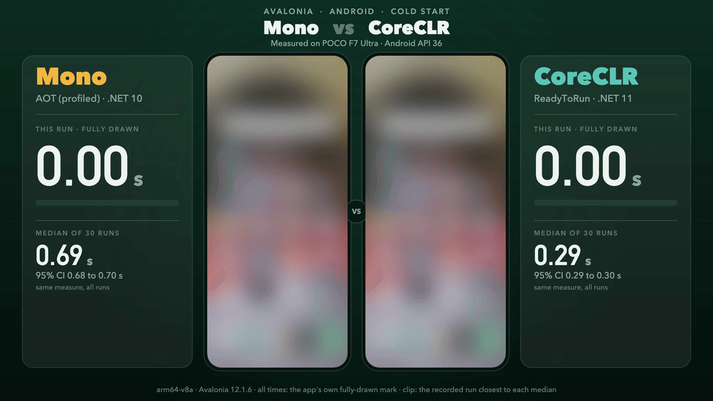

# avalonia-mono-vs-coreclr-android

Does an Avalonia app start faster, slower or bigger on CoreCLR than on Mono? This repo measures it on Android.

.NET for Android is moving from Mono to CoreCLR. CoreCLR is experimental in .NET 10 and the only runtime in .NET 11
(a Mono build there fails with `NETSDK1242`). Anyone moving to .NET 11 gets CoreCLR, so it is worth knowing what changes.

## What we found so far



On a POCO F7 Ultra (Android 16), after a cold start the same Avalonia screen was fully drawn in 692 ms on .NET 10 with
Mono and in 294 ms on .NET 11 with CoreCLR. That is 57.6% less time (95% CI 56.7% to 58.8%, 30 runs each). The CoreCLR
APK is bigger (21.6 MB against 15.8 MB) and uses more memory (180 MB against 154 MB).

Each side of the clip plays the recorded launch closest to its median, one after the other on the same phone, lined up
on the start. The numbers on it come from all 30 runs.

It is one phone on one day, so read it as a first data point. The full report is in
[`results/raw`](results/raw/dashboard_poco-f7-ultra_20261118.report.md).

## What is compared

The main comparison is Mono on .NET 10 (the default release build, with profiled AOT) against CoreCLR on .NET 11,
because that is what an upgrade looks like. App code, Avalonia version and signing are the same on both sides.

The repo can build other combinations too: Mono with JIT only, Mono with full AOT, and CoreCLR on .NET 10. Each one is
called an entry and written `<sdk>/<variant>`, for example `net10/mono-aot-profiled` or `net11/coreclr`. The exact
build settings are in [`eng/Variants.props`](eng/Variants.props).

There are two test apps. `dashboard` is a made-up home-energy screen (a gauge, a chart, a list of devices) and measures
startup. `sparkle` is a particle demo that measures frame pacing.

## Try it

You need the .NET 10 and .NET 11 SDKs with the Android workload (`dotnet workload install android`), `adb`, and a
device with USB debugging on. Add `ffmpeg` if you want the video.

```bash
dotnet run --project tools/Bench -c Release -- build
dotnet run --project tools/Bench -c Release -- compare net10/mono-aot-profiled net11/coreclr
```

`build` makes the APKs. `compare` installs both on the device, runs 30 cold starts of each, records a few launches and
produces a report and a side-by-side video. Add `--serial <id>` if more than one device is connected.

Everything else, including how to set up a real phone, is in [`docs/bench.md`](docs/bench.md). How the measurements are
controlled, and what to report with a claim, is in [`docs/methodology.md`](docs/methodology.md).

## What's where

- `src/` has the two test apps.
- `tools/` has the `bench` command line and its tests.
- `eng/` has the build settings per variant and the SDK pin per track.
- `third_party/` has the sparkle demo and its licences.
- `results/` has raw CSVs and reports.
- `repros/` has a small repro app for a CoreCLR startup problem on .NET 10.
- `docs/` has the tool reference, the methodology and the GIF shown above (`docs/media`).

## Credits and licence

The sparkle demo is an Avalonia port of gskinner's
[Flutter Vignette `sparkle_party`](https://github.com/gskinnerTeam/flutter_vignettes/tree/master/vignettes/sparkle_party)
(MIT, copyright 2019 gskinner.com, inc.), copied from
[avalonia_vignettes](https://github.com/jsuarezruiz/avalonia_vignettes). The copy, its notices and what was changed are in
[`third_party/avalonia_vignettes`](third_party/avalonia_vignettes).

This repo is MIT, see [`LICENSE`](LICENSE). `third_party/` keeps its own licences, including the fonts (SIL OFL 1.1 and
Apache 2.0). The video is drawn with [SkiaSharp](https://github.com/mono/SkiaSharp) (MIT). The app icon in
`src/Common.Android` is the Avalonia logo.
